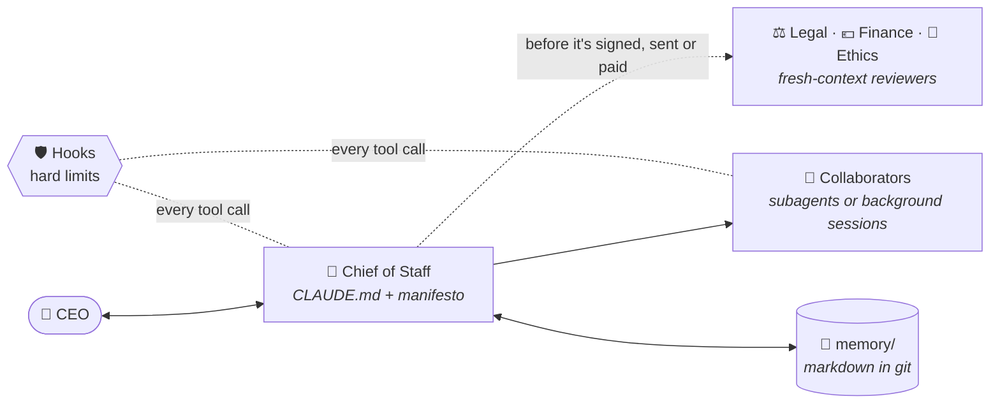

<div align="center">

# 🧭 juvant-os

### Run your company with Claude, without losing control of it.

A Chief of Staff in Claude Code, three advisors who never veto,<br>
memory you can read in git, and hard limits that hold.

[](https://github.com/juvantlabs/juvant-os/actions/workflows/v2.yml)
[](https://github.com/juvantlabs/juvant-os/releases/latest)
[](LICENSE)
[](https://docs.anthropic.com/en/docs/claude-code)

[**Quick start**](#-quick-start) · [**How it works**](#%EF%B8%8F-how-it-works) · [**Hard limits**](#%EF%B8%8F-hard-limits) · [**Skills**](#-skills) · [**Try Morvento**](#-try-it-on-morvento) · [**Coming from v1**](#%EF%B8%8F-coming-from-v1)

</div>

---

## ✨ What is juvant-os?

juvant-os turns a private git repository into a small company's operating system, run from [Claude Code](https://docs.anthropic.com/en/docs/claude-code).

You, the CEO, talk to one agent: your **Chief of Staff**. It does the small things itself and brings in collaborators for the rest. Before anything is signed, sent or paid, **legal**, **finance** and **ethics** read it with fresh eyes. They advise; you decide.

Everything the company knows lives as plain markdown in its own repository: decisions, facts, journal, deadlines. Nothing runs behind your back. A few rules are not left to the model at all: **hooks enforce them on every tool call.**

<table>
<tr>
<td width="33%" valign="top">

### 🗣️ One conversation
The Chief of Staff is the only agent you have to talk to. It briefs collaborators, runs long tasks while you're away, and tells you what is waiting for you.

</td>
<td width="33%" valign="top">

### 📜 One manifesto
A single page says how your company thinks. Every agent receives it at the start of every session, so values travel to cases no rule foresaw.

</td>
<td width="33%" valign="top">

### 🔒 Hard limits
Agents draft, you send. No payments. No secrets in the repo. Nothing overwritten or deleted without you. Checked by hooks, not left to good intentions.

</td>
</tr>
</table>

---

## 🏗️ How it works



| Piece | What it is | Where it lives |
|---|---|---|
| 🧭 **Chief of Staff** | Your counterpart. Small work itself, bigger work to collaborators, decisions back to you with a recommendation. | `CLAUDE.md` |
| 📜 **Manifesto** | Who you are, what you value, how you decide, what you never do, how you sound. One page. | `manifesto.md` |
| ⚖️💶🌱 **Advisors** | Legal, finance and ethics. Read-only reviewers that return a verdict and findings, never a decision. Each has a name and a role card with your positions: payment terms, liability caps, cash buffer, the lines you hold. | `roles/*.md`, `.claude/agents/` |
| 🤝 **Collaborators** | Marketing, technology, anything else: general-purpose agents with a brief and the right skills. Quick tasks run as subagents; long ones as background sessions you can open and join. | started on demand |
| 🧠 **Memory** | Decisions, durable facts, a daily journal, deadlines, project cards. Searchable with `grep`, reviewable in every commit. | `memory/` |
| 🛡️ **Hooks** | Hard limits, the manifesto injected at start, reviewer nudges, private files, an activity log. | `.claude/hooks/` |
| 📊 **Dashboard** | A read-only page built from the repo by a script and published privately to you on claude.ai. | `.claude/dashboard/` |

---

## 🛡️ Hard limits

The same in every session, for every agent, enforced by hooks before the tool runs:

| | Limit | In practice |
|:-:|---|---|
| ✉️ | **Outbound is draft-only** | Agents draft mail, posts, invites and contracts. Sending, forwarding, replying, publishing and sharing are denied: the CEO sends. |
| 💳 | **No money movement** | Payments, transfers, refunds and issuing invoices are denied. Reading the bank and the invoices is fine. Money moves in the vendor's own UI, by the CEO. |
| 🔑 | **No secrets** | Secret-shaped text is refused in files, memory and commands. Secrets are stored by the CEO, from their own terminal. |
| 🗑️ | **Nothing lost without the CEO** | Overwriting, deleting, moving and renaming documents or mail, `git reset --hard` and `git clean -f` ask the CEO. Force push is denied. Creating never asks: uploads set their conflict behaviour to `fail` or `rename`. |

A company can **add** its own rules in `.claude/limits-company.json`, never remove one. A file can be made **private** to some roles only, with the `private-file` skill. For a long unattended task, the CEO approves an **authorization** once, at the start; money, outbound and secrets stay denied anyway.

> [!IMPORTANT]
> The hard limits are **guardrails against mistakes, not isolation.** They stop an agent from doing the wrong thing by accident; they are not a sandbox against a determined attacker on your machine.

---

## 🧰 Skills

31 skills ship with the framework. The Chief of Staff and the advisors load them when a task matches.

| | Area | Skills |
|:-:|---|---|
| ⚖️ | **Legal** | `review-contract` · `triage-nda` · `legal-risk-assessment` · `compliance-check` · `vendor-check` |
| 💶 | **Finance** | `cash-flow-snapshot` · `invoice-chase` · `month-end-prep` · `reconciliation` · `variance-analysis` · `financial-statements` |
| 📣 | **Marketing** | `brand-review` · `campaign-plan` · `content-creation` · `competitive-brief` |
| 💼 | **Running the business** | `business-pulse` · `monday-brief` · `inbox-manager` · `proposal-builder` |
| 🧠 | **Memory** | `decision` · `knowledge` · `new-project` · `wrap-up` |
| 🤝 | **Working with agents** | `start-collaborator` · `long-task` |
| 🔐 | **Control** | `private-file` · `project-repo` · `dashboard` |
| 🔄 | **Framework** | `update` · `bugfix` · `country-pack` |

Many legal, finance, marketing and small-business skills are adapted from [anthropics/knowledge-work-plugins](https://github.com/anthropics/knowledge-work-plugins) (Apache 2.0) for juvant-os: company context, draft-only outbound, local practice. Details in [`framework/skills/THIRD_PARTY.md`](framework/skills/THIRD_PARTY.md).

### 🌍 Country packs

Skills are country-neutral. A country pack adds the local legal, fiscal, marketing and format rules: 🇮🇹 **Italy** ships today (`--country it`: e-invoicing, F24, GDPR practice, formats). For another country, the `country-pack` skill drafts one with you in the first session.

---

## 🚀 Quick start

**You need:** [Claude Code](https://docs.anthropic.com/en/docs/claude-code), `git`, `bash`, `python3` and `curl`, on macOS or Linux.

**1. Install from an official release** (juvant-os installs from nothing else):

```bash
git clone --branch v2.1.1 https://github.com/juvantlabs/juvant-os.git /tmp/juvant-os
bash /tmp/juvant-os/setup.sh ~/Projects/acme --company "Acme" --language English
```

Add `--country it` for the Italian pack. You can also pass `--ceo`, `--cos`, `--legal`, `--finance` and `--ethics` names; whatever you leave out, the Chief of Staff fills in with you.

**2. Make it a repository and start your Chief of Staff:**

```bash
cd ~/Projects/acme
git init
claude --name cos --remote-control
```

**3. In the first session**, the Chief of Staff writes the manifesto with you, names the advisors, fills in the role cards and records the setup as your first decision. Then commit, ideally to a **private** repository.

**4. Stay up to date.** Ask *"is there an update for juvant-os?"*. The `update` skill installs the latest official release and never touches the files your company has made its own: manifesto, role cards, `CLAUDE.md`, memory.

> [!TIP]
> Found a defect in the framework? The `bugfix` skill sends the fix upstream as a draft pull request, or as a private security report.

---

## 🧪 Try it on Morvento

[`examples/morvento/`](examples/morvento/) is a complete company you can play with: a **fictional** Italian B2B software and consulting firm, six people, on Microsoft 365. It has a manifesto, named advisors (Ettore, Greta, Leone), a Chief of Staff called Nora, memory, and test documents with known problems: a client contract with bad clauses, a client who pays late.

```bash
cp -R examples/morvento /tmp/morvento && cd /tmp/morvento
git init && claude
```

Then try *"review the contract in samples/contracts"*, or *"who owes us money?"*.

---

## 📁 Repository layout

| Path | What |
|---|---|
| 📦 [`framework/`](framework/) | Everything `setup` and `update` install into a company repository: agents, skills, hooks, dashboard, templates, country packs |
| 🧪 [`examples/morvento/`](examples/morvento/) | The fictional reference company, kept in sync with the framework by CI |
| 🧳 [`tools/`](tools/), [`docs/migrating-from-v1.md`](docs/migrating-from-v1.md) | Moving a v1 company to v2 |
| ✅ [`tests/`](tests/) | Lint, the `framework/FILES` check, unit and end-to-end tests: `bash tests/run.sh` |

---

## ↩️ Coming from v1

v1 is frozen on the [`v1` branch](https://github.com/juvantlabs/juvant-os/tree/v1). Instances on v1.22.2 or later sync from there and aren't affected by v2 on `main`.

> [!WARNING]
> **On an older v1, don't sync from `main`.** Move to v1.22.2 or later from the `v1` branch first. v2 doesn't install over v1: see [moving a company from v1 to v2](docs/migrating-from-v1.md).

What changed: v2 is much lighter. Instead of a dozen named C-level agents, a database and scheduled jobs, it has one Chief of Staff, three advisors, markdown memory in git and hooks written in Python.

---

## 🤝 Contributing and security

- 🐛 **Contributions:** see [CONTRIBUTING.md](CONTRIBUTING.md). Adopters send framework fixes with the `bugfix` skill.
- 🔐 **Vulnerabilities:** report them privately, as described in [SECURITY.md](SECURITY.md). Please don't open a public issue.

---

<div align="center">

**MIT licensed** · see [LICENSE](LICENSE)

Maintained by [juvantlabs](https://github.com/juvantlabs), built with Claude Code

</div>
